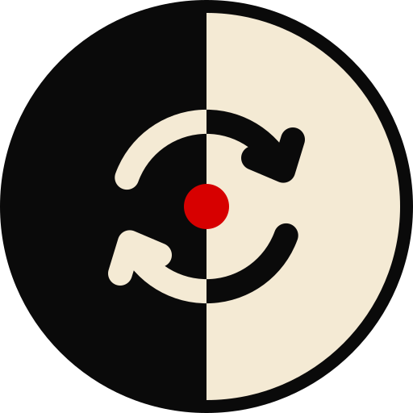
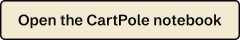
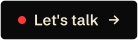

<picture>
  <source media="(prefers-color-scheme: dark)" srcset="https://raw.githubusercontent.com/voaneves/colab-rl/master/assets/logo/logo-dark.svg" />
  <source media="(prefers-color-scheme: light)" srcset="https://raw.githubusercontent.com/voaneves/colab-rl/master/assets/logo/logo-light.svg" />
  
</picture>

<h1>colab-rl</h1>

  <strong>Keras reinforcement learning agents you can train in Google Colab, starting with DQN.</strong> 
  Notebooks ready to run in the cloud

  
  

Need something like this? <a href="https://voaneves.com/en/#contact"><strong>Let's talk →</strong></a>

  
  
  

  <a href="#about-the-project">About</a> ·
  <a href="#features">Features</a> ·
  <a href="#notebooks">Notebooks</a> ·
  <a href="#contributing">Contributing</a> ·
  <a href="#to-do">To do</a> ·
  <a href="#contact">Contact</a>

<picture>
  <source media="(prefers-color-scheme: dark)" srcset="https://raw.githubusercontent.com/voaneves/colab-rl/master/assets/brand/rule-dark.svg" />
  <source media="(prefers-color-scheme: light)" srcset="https://raw.githubusercontent.com/voaneves/colab-rl/master/assets/brand/rule-light.svg" />
  
</picture>

## About the project

Train a deep reinforcement learning agent on your own task, using Keras code that is ready to run in Google Colab.

The project provides a Keras implementation of Deep Q-Networks that researchers and practitioners can use to train and evaluate agents on different environments. PPO and A2C are not implemented here yet; the only related code is the CartPole actor-critic notebook below.

## Features

- **DQN in Keras:** `models/dqn.py`, with prioritized experience replay (sum tree), noisy dense layers and benchmarked variants under `models/benchmarking_models/`.
- **Google Colab ready:** notebooks run in Colab, so you can experiment and train with cloud resources.
- **Customizable and extensible:** the code is designed to be modified and adapted to your own tasks.

## Notebooks

- [`actor_critic_cartpole.ipynb`](https://colab.research.google.com/github/voaneves/colab-rl/blob/master/notebooks/actor_critic_cartpole.ipynb): an actor-critic agent on the CartPole environment, ready to open in Colab.
- [`snake-with-dqn-agent.ipynb`](notebooks/snake-with-dqn-agent.ipynb): an introduction to the Snake game with a DQN agent. It points to the old SnakeAI repository, which became [snake-on-pygame](https://github.com/voaneves/snake-on-pygame).

The `notebooks/` folder also holds experiments from other projects. To train DQN locally on Snake, run `python run_dqn.py` (see the [snake-on-pygame](https://github.com/voaneves/snake-on-pygame#using-colab-rl) README).

## Contributing

Contributions are welcome. If you would like to add algorithms, improve existing implementations or help in any other way:

1. Fork the repository.
2. Create a new branch: `git checkout -b my-branch`.
3. Make your changes and commit them: `git commit -m 'Add some feature'`.
4. Push the changes to your fork: `git push origin my-branch`.
5. Open a pull request and describe the changes you made.

## To do

- [ ] Improve the "Notebooks" section of this README.
- [ ] Review all notebooks to check which ones still work.

## Contact

  <a href="https://voaneves.com/en/#contact"><picture><source media="(prefers-color-scheme: dark)" srcset="https://raw.githubusercontent.com/voaneves/colab-rl/master/assets/buttons/hire-dark.svg" /></picture></a>
  <a href="https://voaneves.com/en/"><picture><source media="(prefers-color-scheme: dark)" srcset="https://raw.githubusercontent.com/voaneves/colab-rl/master/assets/buttons/site-dark.svg" /></picture></a>

<a href="https://linkedin.com/in/voaneves">LinkedIn</a> · <a href="mailto:victorneves478@gmail.com">E-mail</a>

  

Released under the .

<a href="#top">↑ Back to top</a>

